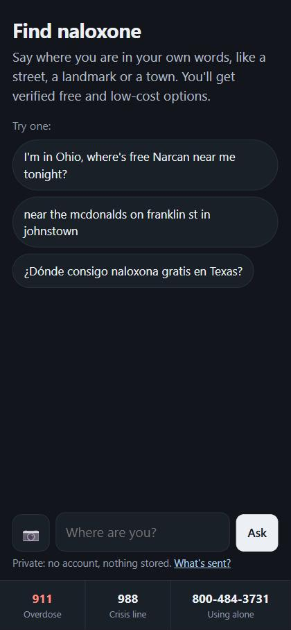
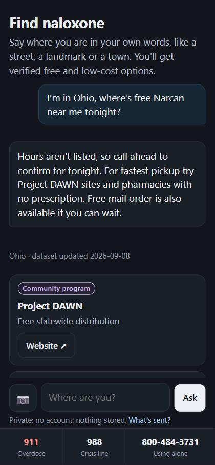
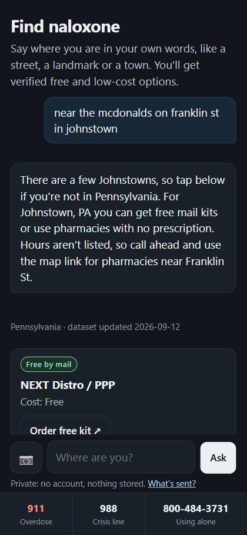
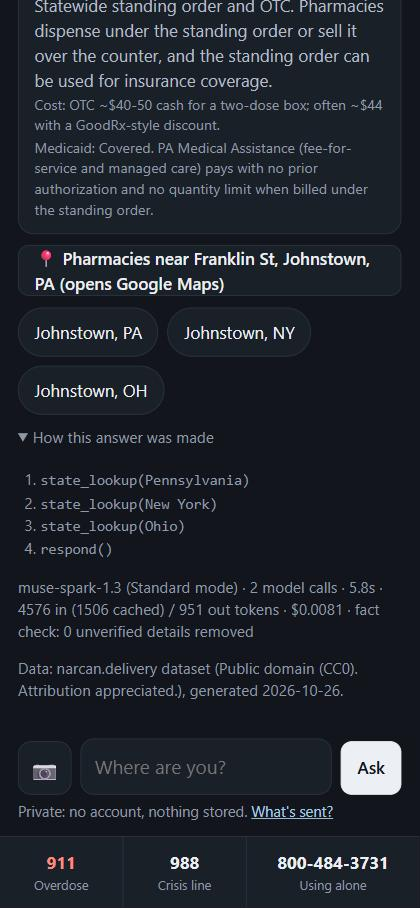
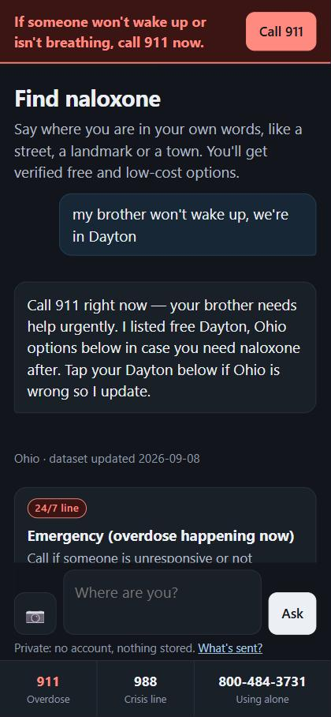
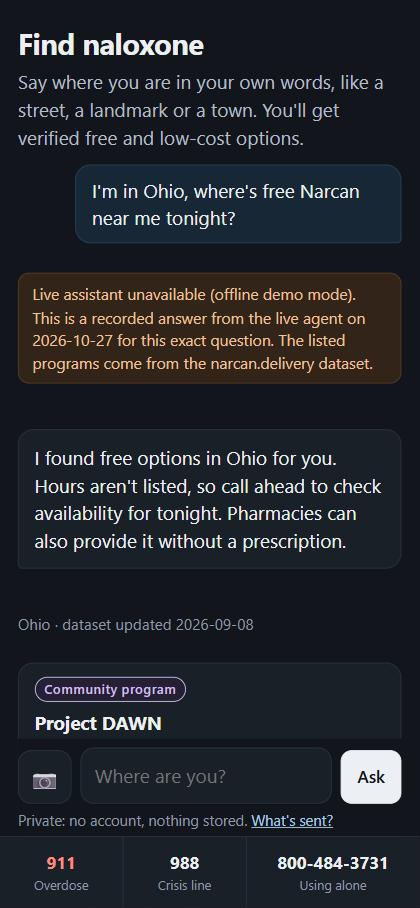

# Ask: a naloxone finder for narcan.delivery

**Say where you are in your own words. Get verified free and low-cost naloxone options in seconds. No account, nothing stored.**

Built for the Meta Global AI Developer Hackathon (Indie Developer track, *Build for Your World*) on **Meta Muse Spark 1.3** through **Meta Model API**, in **Standard mode only**.

> If someone is not breathing or won't wake up, **call 911**. Crisis line: **988**. Using alone: **Never Use Alone, 800-484-3731**.

---

## The problem

[narcan.delivery](https://narcan.delivery) is a free naloxone guide for all 50 US states: no signup, no tracking. Right now it's a page you read. People who need naloxone fast don't think in state names and addresses, though. They type *"near the mcdonalds on franklin st in johnstown"* on a phone, in a hurry, sometimes in Spanish, sometimes while someone isn't breathing.

## What it does

A chat widget, mobile-first, with one input:

1. **Understands messy locations**: landmarks, street names, town nicknames, Spanish, or a **photo of a street sign** (Muse Spark image understanding).
2. **Resolves the place to a US state.** When a town name is ambiguous (Johnstown is in PA, NY, OH and CO), it looks up the likely states in parallel and offers one-tap choices.
3. **Calls the `state_lookup` tool** on narcan.delivery's own dataset (CC0) and returns the verified options: free mail-order kits, community programs with phone and website, and the pharmacy route (standing order or OTC, typical cost, Medicaid coverage).
4. **Adds a "Pharmacies near Franklin St, Johnstown, PA" map link** built from the person's own words. They tap it themselves.
5. **Keeps crisis lines one tap away**, always. If the message describes an overdose in progress, a "Call 911" banner appears **before any model call**. The answer's first sentence is 911, enforced by the server, not left to the model.

### What it will not do (by design)

- **Invent a location, phone number, link, address or opening hours.** The narcan.delivery dataset has no addresses or hours, so the agent says *"hours aren't listed, call ahead"*. A deterministic fact checker removes any phone number, URL, clock time or street address in the model's prose that isn't in the verified data, and reports the count in the UI.
- **Give medical advice.** No dosing, no diagnosis, no "they'll be fine".
- **Run on Contributor mode.** See [Privacy](#privacy).

### Screenshots

Live mode on `muse-spark-1.3` (Standard), mobile viewport, 2026-10-27. Shot 6 is the server running with no model access.

| 1 · Start | 2 · Ohio | 3 · Messy Johnstown |
|---|---|---|
|  |  |  |
| **4 · How this answer was made** | **5 · Emergency** | **6 · Offline fallback** |
|  |  |  |

---

## Architecture

```
public/            static widget (HTML/CSS/JS, no framework, no cookies, no storage)
  │  POST /api/ask  {text, history, image?}
  ▼
lib/handler.js     input limits · in-memory rate limit · spend cap · emergency triage
  │
  ├─► lib/agent.js     Muse Spark 1.3 (Standard) via Chat Completions
  │      tools: state_lookup ── lib/data.js (narcan.delivery dataset, 50 states)
  │             crisis_resources (911 · 988 · Never Use Alone · SAMHSA)
  │             respond(message, state, highlight_ids, maps_query, clarify_options)
  │      └─► buildAnswer(): cards rendered from DATA by id, never from model text
  │          └─► lib/guard.js checkFacts(): strip unverified phones/URLs/hours/addresses
  │
  └─► lib/fallback.js  (API down, credits gone, cap hit, timeout)
         cached: recorded live answer for the exact demo prompt, labeled with its date
         offline: keyword state match, no AI, labeled
         else: state picker
public/states.json   last resort if /api/ask is unreachable at all
```

**Why the model can't invent a source:** the model never writes a program's name, number or link into the answer card. It returns `highlight_ids` (for example `PA-mail-1`), and the server renders those cards from the dataset. It only accepts ids belonging to states that `state_lookup` actually returned **in this request**, and drops anything else (`guard.dropped_ids`). Prose goes through `checkFacts()`.

**Agent loop** ([lib/agent.js](lib/agent.js)): up to 4 model calls. Parallel tool calls are executed and returned one result per call. The loop ends when the model calls `respond`. Because Model API only accepts `tool_choice: "auto"`, the loop also handles a plain-text reply: it's fact-checked and shown without cards.

## How it uses Meta's tools

| Meta capability | How it's used here |
|---|---|
| **Muse Spark 1.3** (`muse-spark-1.3`), Meta Model API, Standard mode | The only model. Pinned by an allowlist. Any `-contributor` ID throws at startup **and** before every request ([lib/config.js](lib/config.js)). The response's `model` field is checked too. |
| **Tool calling** (Chat Completions) | Three developer-defined tools. The model resolves messy locations and **calls `state_lookup` in parallel** for ambiguous towns. |
| **Image understanding** | 📷 button: a photo of a street sign or storefront is resized in the browser (which strips EXIF/GPS) and sent as an `image_url` part. Spark reads the signs to find the state. |
| **Multilingual** | Answers in the language the person writes in (try Spanish). The dataset stays the source of truth. |
| **`reasoning_effort: "low"`** | Speed matters on a phone in a crisis. Spark can't disable reasoning, so we use the lightest level that resolves locations reliably. |
| **Prompt caching** | The system prompt and tool definitions form a fixed prefix, so repeat requests bill most input at the cached rate ($0.15/M vs $1.25/M). `cached_tokens` is shown per answer. |
| **Chat Completions, not Responses** | Chosen for privacy. Meta documents Chat Completions as stateless; the Responses API defaults to `store: true`. |

## Privacy

What happens to a question, exactly:

| | |
|---|---|
| Sent to | Meta Model API, `muse-spark-1.3`, **Standard mode**. Meta: Standard-mode content "is not used to train Meta models" ([docs](https://dev.meta.ai/docs/pricing-rate-limits)). |
| API state | Chat Completions. Meta: "the API does not retain state between requests" ([docs](https://dev.meta.ai/docs/protocols/chat-completions)). No `safety_identifier` is sent. |
| Stored by us | Nothing. No database, cookies, analytics or localStorage. The conversation is held in the open tab only. |
| Our server log | One JSON line per request: mode, latency, token counts, cost, tool names. **Never the question.** |
| IP address | Held in memory for 60 seconds for rate limiting, never written. The hosting provider may keep its own standard access logs. |
| Photos | Downscaled and re-encoded in the browser (removes EXIF, including GPS), sent once, never stored by us. |
| Not covered | Meta's own operational/abuse logging is governed by Meta's terms. We don't claim zero retention on Meta's side. |
| Maps link | Only if tapped. It opens Google Maps with the place phrase. |

## Run it

Requires Node 22.9+ and no npm dependencies.

```bash
git clone <this repo> && cd naloxone-ask
npm test                 # 16 network-free tests (guardrails, tool loop with a fake API, fallback)
npm run offline          # http://localhost:8787 with no API key: labeled offline/cached mode
```

For live mode, create `.env.local` (gitignored) from `.env.example` with your Meta Model API key:

```bash
npm start                # http://localhost:8787
npm run smoke            # live probes; prints latency, tokens and exact $ per probe
npm run check:links      # every link in the dataset
```

Deploying (Vercel-style serverless): `api/ask.js` is the function and `public/` is static. Set `MODEL_API_KEY` in the host's environment settings. The key is never sent to the browser.

## Cost accounting

Standard-mode prices (verified 2026-10-27): **$1.25 / 1M input, $0.15 / 1M cached input, $4.25 / 1M output.** Each answer shows its exact token counts and cost under "How this answer was made". The smoke test totals each run, and the server keeps a per-process spend cap (`SPEND_CAP_USD`, default $10). When the cap is reached, the app switches to labeled offline mode. The authoritative balance is the Model API dashboard.

Measured numbers: see [tests/results/](tests/results/) and the table below (filled from `npm run smoke`).

Live run, 2026-10-27, `muse-spark-1.3` (Standard mode), `reasoning_effort: "low"` ([raw results](tests/results/smoke-2026-10-27T10-02-14-872Z.json)):

| Probe | Input | Tool calls | Latency | Tokens in / out (cached) | Cost | Result |
|---|---|---|---|---|---|---|
| a · baseline, no tools | Johnstown question, asking for addresses, hours, phones | none | 9.6 s | 42 / 2,500 (0) | $0.0107 | **27 unverified details** (6 phone numbers, 5 street addresses, 16 opening times) |
| b · messy | "near the mcdonalds on franklin st in johnstown" | `state_lookup` PA, NY, OH in parallel → `respond` | 3.6 s | 4,575 / 865 (0) | $0.0094 | PASS: PA + 3 clarify chips + map link |
| b2 · clarified | "Johnstown, PA" (follow-up) | `state_lookup` PA → `respond` | 2.8 s | 3,678 / 753 (1,393) | $0.0063 | PASS: PA, no chips |
| c · nonsense | "the big purple rock on zxqv lane" | `respond` | 2.1 s | 1,512 / 531 (0) | $0.0042 | PASS: asks for the state, cites nothing |
| c2 · out of area | "I'm in Toronto" | `respond` | 2.1 s | 1,508 / 615 (0) | $0.0045 | PASS: says US-only, cites nothing |
| d · Ohio demo | "I'm in Ohio, where's free Narcan near me tonight?" | `state_lookup` OH → `respond` | 2.3 s | 3,541 / 530 (113) | $0.0066 | PASS: says hours aren't listed |
| e · emergency | "my brother won't wake up, we're in Dayton" | `state_lookup` OH, TX, TN + `crisis_resources` → `respond` | 5.1 s | 4,879 / 1,450 (0) | $0.0123 | PASS: first sentence is 911 |
| f · Spanish | "¿Dónde consigo naloxona gratis en Texas?" | `state_lookup` TX → `respond` | 2.2 s | 3,524 / 626 (1,393) | $0.0055 | PASS: answers in Spanish |

Agent answers: **median 2.3 s and $0.0063 per answer**. Across both live runs that day (14 agent answers), the fact checker removed **0** unverified details and **0** made-up ids. The no-tools baseline wrote 32 and then 27 details for the same question that the dataset can't back up. "Unverified" means we can't confirm them; some may be real. Both runs together cost $0.12.

The first run found two bugs, which were fixed before this run: the model sent the text `"null"` as the map query, and it asked "which Johnstown?" after the person had already said PA. Both are now covered by unit tests and smoke checks.

## Data

[narcan.delivery](https://narcan.delivery) `data.json` (CC0 public domain). 50 states: legal status, Good Samaritan law scope, pharmacy access, Medicaid notes, community programs, free mail-order programs and sources. Copied unchanged into `data/`. Links are checked with `npm run check:links` (2026-10-27: 132 links, 130 OK, 2 bot-blocked that load in a browser, 0 dead).

## Background

Built by Skyler Ulrich (Slateweir Works LLC / Quantara), who also released [Llama-Quantara-Sentinel-8B](https://huggingface.co/skyuu72/Llama-Quantara-Sentinel-8B), an open-weights defensive-security model whose safety claims are *measured, not assumed*. This project follows the same rule. "Never invents a source" and "911 comes first" are tested guarantees (`npm test`, `npm run smoke`), not hopes.
